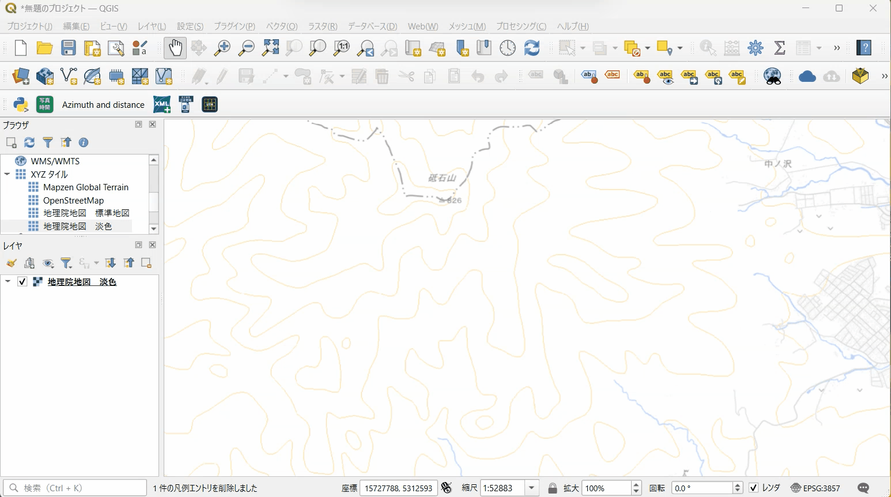

# KK_Create_UTM_Grid

指定した範囲に、UTM（MGRS）グリッドを作成するQGISプラグインです。メッシュサイズは10 kmから1 mまで選択できます。UTMゾーンをまたぐ範囲では、ゾーンごとにレイヤを分けて作成します。

## デモ

## 主な機能

- 10 km、1 km、100 m、10 m、1 mのグリッドを作成
- QGISのマップキャンバスまたは範囲指定コントロールで描画領域を指定
- UTMゾーンをまたぐ場合は、ゾーンごとに別のグリッドレイヤを作成
- MGRSコードやメッシュサイズ、UTMゾーンなどを属性として付与
- 同じ名前の対応レイヤがすでにある場合、重複するセルを除いて新しいセルを追加
- 同梱の `mgrs_style.qml` を新規レイヤに適用し、MGRSラベルを表示

## インストール

QGISのプラグイン管理画面からZIPファイルを指定してインストールします。

1. QGISで **プラグイン** メニューを開き、**プラグインの管理とインストール** を選択します。
2. **ZIPからインストール** を開きます。
3. [`インストール用ZIP/KK_Create_UTM_Grid_0.9.1.zip`](インストール用ZIP/KK_Create_UTM_Grid_0.9.1.zip) を選択してインストールします。
4. プラグインを有効にします。

QGIS 3.34以降に対応しています。

## 使い方

1. QGISのプラグインツールバー、または **ベクタ** メニューから **UTMグリッド作成** をクリックします。
2. 右側に表示される **UTMグリッド作成** パネルで、メッシュサイズと描画領域を指定します。
3. **グリッド作成** をクリックします。
4. 作成が終わると、レイヤがプロジェクトに追加され、QGISのメッセージバーとパネルに結果が表示されます。

### パネルのボタン・項目

| 項目 | 説明 |
| --- | --- |
| **UTMグリッド作成**（ツールバー／ベクタメニュー） | グリッド作成パネルを表示します。パネルを閉じた後も、クリックすると再表示できます。 |
| **メッシュサイズ** | 作成するセルの一辺を選びます。`10km`、`1km`、`100m`、`10m`、`1m`から選択でき、初期値は`1km`です。 |
| **描画領域** | グリッドを作る範囲を指定します。初期値は現在のマップキャンバスの表示範囲です。範囲と座標参照系は、必要に応じて変更できます。 |
| **グリッド作成** | 指定内容でグリッドを生成します。処理中はボタンが無効になり、パネル下部に進捗や結果が表示されます。 |
| **ステータス表示** | 件数の確認、進捗、完了件数、エラーなどを表示します。 |

## 作成されるレイヤ

- レイヤ名は `ゾーン番号_メッシュサイズ_UTMグリッド` です（例：`55_10m_UTMグリッド`）。
- UTMゾーンごとに別レイヤを作成します。複数ゾーンにまたがる範囲では、複数のレイヤが追加されます。
- グリッドはポリゴンのメモリレイヤとして作成されます。後からも使えるようにするには、QGISの **エクスポート** 機能でGeoPackageなどに保存してください。
- 属性には、MGRSコード（空白なし／区切りあり）、メッシュサイズ、UTMゾーン、緯度帯、100 km正方形識別子、UTM座標などが含まれます。
- 同じ名前の対応レイヤがプロジェクトにある場合は、既存レイヤへ追加します。すでに登録されているセルは重複追加せず、スキップ件数を結果に表示します。別の範囲を順次追加したい場合は、既存レイヤの名前を変更しないでください。

## 注意事項

- 対象範囲はMGRSのUTM範囲である南緯80度から北緯84度までです。日付変更線をまたぐ範囲には対応していません。
- 作成予定数が200,000件を超える場合、続行するか確認するダイアログが表示されます。大きな範囲や細かいメッシュでは、処理に時間がかかりメモリを多く使用します。
- 既定スタイルは同梱の `mgrs_style.qml` から読み込みます。新規レイヤのスタイルが反映されない場合は、このファイルがプラグインフォルダにあることを確認してください。

## ライセンス

詳細は[LICENSE](plugins/KK_Create_UTM_Grid/LICENSE)を参照してください。
